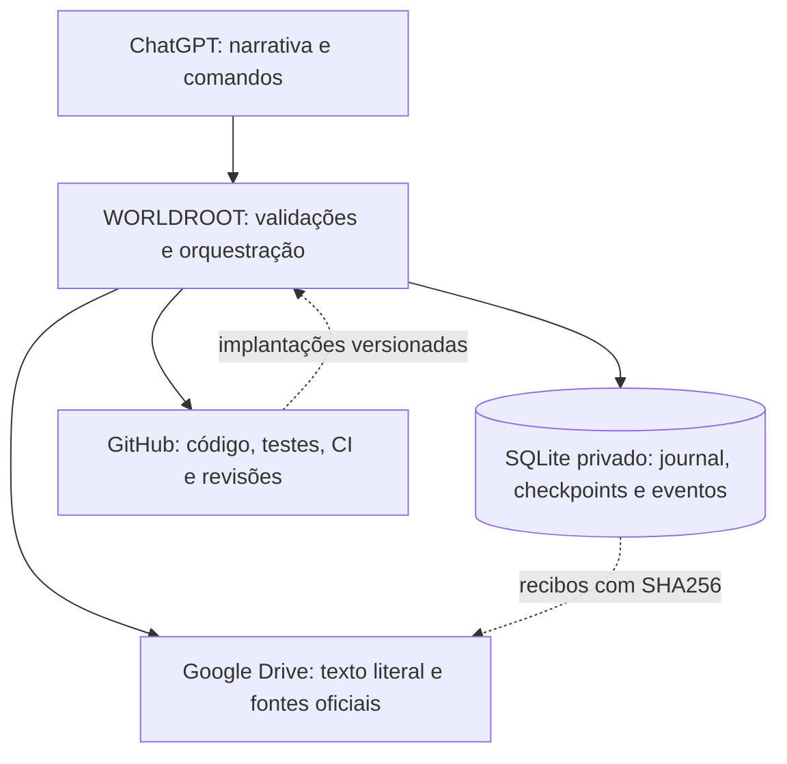

# WORLDROOT — CRÔNICAS DE UM NOVO MUNDO

**Repository role:** public *source code only* for the narrative persistence layer. **No chapter text, backups, unpublished plots, character secrets or SQLite archives should ever be committed.** The authoritative story documents live in the project's restricted Google Drive folder; the operational ledger is local/private.

## Architecture



The code does **not** claim a live server or automatic ChatGPT hook. A ChatGPT session with access to authenticated tools can call the relevant Drive/GitHub connector actions; this module alone has no privileged cloud access.

## Zero-cost installation and local test

```bash
python -m unittest discover -s tests -v
python -m worldroot.cli --root ./runtime status
```

Use `python -m worldroot.cli --help` for preparation/validation/archiving. The `.gitignore` intentionally excludes runtime/private/story content. The adapter accepts only a *verified* Drive readback hash before a delivered part may be promoted to canonical state.

## Narrative publication protocol

`PREPARADO → VALIDADO → GRAVADO → CONFERIDO → CONFIRMADO`

1. The author selects a continuation; the assistant narrates the full text.
2. Prepare a stable delivery ID, full UTF-8 text and SHA256, strict date/location metadata, proposed events and visibility labels.
3. Validate metadata and expected chronology; store literal bytes atomically, then read them back locally.
4. A connected orchestrator uploads the same bytes to the authorized Google Drive location and **fetches the bytes again**. It registers the verified external receipt; generation or upload alone is not enough.
5. `confirm` closes the ledger **only after a verified Drive readback**, and `promote` may update the canonical checkpoint only with explicit author approval and verified external receipt. HEAD/Atlas synchronization needs an additional authorized adapter with independent readback and a failure queue; it is **not implemented by this repository**.
6. Rerun operations safely: same ID and bytes are idempotent; altered content for an existing delivery ID is rejected.

See `docs/architecture.md` and `docs/release-r7.md` for interfaces and release qualification. Synthetic tests do not prove every historical day or character relationship has been reconciled.
