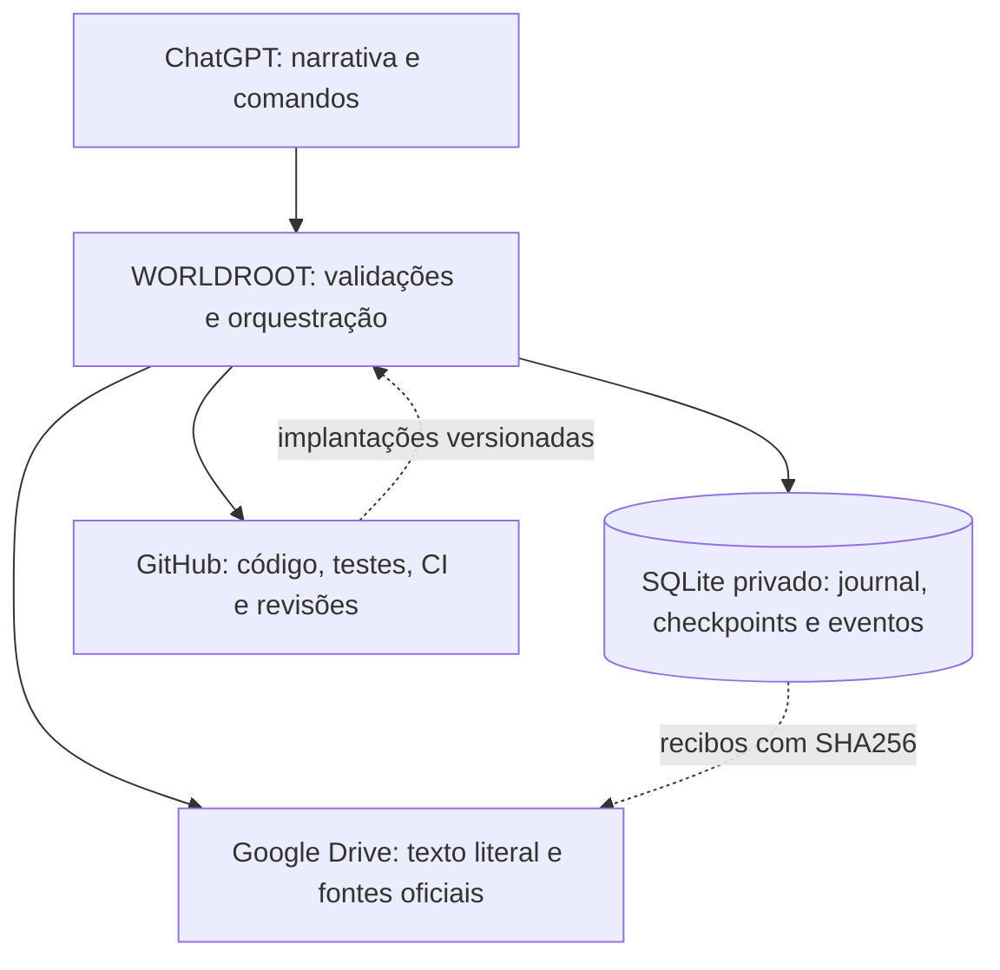

# WORLDROOT — CRÔNICAS DE UM NOVO MUNDO

**Repository role:** PRIVATE story and source-code history. Code is developed on `worldroot/**`; the original story text and recovery packages are stored in `story-archive`. Google Drive remains the authoritative narrative document archive; SQLite is an operational projection and must be durably backed up. Do not log character secrets, credentials, or unpublished scenes in CI outputs or external issues.

## Hardening lane — P0–P2

This branch hardens r7 without retcon: `worldroot/drive_bridge.py` provides a real Google Drive API transport (optional `pip install .[drive]` + trusted ADC credentials), `worldroot/memory.py` provides evidence-first per-character temporal knowledge, `worldroot/narrative.py` provides book/choices/style preflight, `worldroot/backup.py` provides restore-verified SQLite backups, and `worldroot/legacy.py` reads the existing 4.3 FTS archive without modifying it.

**No authenticated runtime credentials are configured in the repository or in GitHub Actions.** The Drive synchronizer is tested with synthetic fixtures; the production cloud bridge, Base/Atlas transaction coordinator and autonomous chapter saving remain pending. Under no circumstances is content from the private 105MB literal index committed to this public repository. See [hardening roadmap](docs/hardening-r7-roadmap.md).

## Architecture



The code does **not** claim a live server or automatic ChatGPT hook. A ChatGPT session with access to authenticated tools can call the relevant Drive/GitHub connector actions; this module alone has no privileged cloud access.

## Zero-cost installation and local test

```bash
python -m unittest discover -s tests -v
python -m worldroot.cli --root ./runtime status
```

Use `python -m worldroot.cli --help` for preparation/validation/archiving. The `.gitignore` intentionally excludes runtime/private/story content. A generic caller-supplied readback is no longer accepted. The trusted production adapter must call Google APIs to fetch bytes and compare hashes; tests explicitly opt in to a fake service. The HEAD publisher also demands a Google Docs revision readback and author approval.

## Narrative publication protocol

`PREPARADO → VALIDADO → GRAVADO → CONFERIDO → CONFIRMADO`

1. The author selects a continuation; the assistant narrates the full text.
2. Prepare a stable delivery ID, full UTF-8 text and SHA256, strict date/location metadata, proposed events and visibility labels.
3. Validate metadata and expected chronology; store literal bytes atomically, then read them back locally.
4. A connected orchestrator uploads the same bytes to the authorized Google Drive location and **fetches the bytes again**. It registers the verified external receipt; generation or upload alone is not enough.
5. `confirm` closes the ledger **only after a verified Drive readback**, and `promote` may update the canonical checkpoint only with explicit author approval and verified external receipt. The HEAD Google Docs CAS adapter and durable outbox now exist, but Base/Atlas and Wiki updates are **not yet coordinated as a full production transaction**.
6. Rerun operations safely: same ID and bytes are idempotent; altered content for an existing delivery ID is rejected.

See `docs/architecture.md` and `docs/release-r7.md` for interfaces and release qualification. Synthetic tests do not prove every historical day or character relationship has been reconciled.

## Explicit live Drive sync (trusted private runtime only)

```bash
# Only after local `prepare`, `validate`, `write` and `verify` have completed:
pip install '.[drive]'
# Set ADC credentials OUTSIDE GitHub in a separately authorized runner.
python -m worldroot.cli --root ./runtime sync-drive --id SYNTHETIC_ID --folder-id ACTUAL_RESTRICTED_FOLDER_ID
```

This command does not send credentials or chapter content to GitHub and does not publish HEAD. If no ADC credentials are present, it fails instead of pretending to upload.

## Episode handoff: draft on options, canon on the next author choice

This project now includes `worldroot/episode_handoff.py`, `worldroot/private_github.py`,
`worldroot/sheets_index.py` and `worldroot/episode_cli.py`. Run:

```sh
python -m unittest discover -s tests -v
python -m worldroot.episode_cli --help
```

**No background ChatGPT hook is installed.** The host must capture the FULL
rendered episode and explicitly run the stage command, then run the closure
command after receiving the next genuine author selection. The story archive
always requires a verified **private** repository and independent readback.
The existing `main` branch remains untouched until a reviewed release.
See [episode lifecycle](docs/ciclo-de-episodios.md).


## Operation status — choice-only goal (r7)

- The private GitHub `story-archive` branch contains the **literal** D529 Part II draft (`LV-C15-PII-D529-AUTHOR-SOURCE`), with SHA256 and five choices; integrity-check GitHub Actions ran **successfully**.
- Latest Drive and GitHub draft reads succeeded. **The official HEAD is still D528.** D529 Part II has not been promoted, and the user's next choice remains outstanding.
- The semantic event sidecar of this immutable draft is `[]`. Evidence-linked **candidates** (11 events, 6 knowledge updates) are in `episodes/LV-C15-PII-D529-AUTHOR-SOURCE/review/`. They are NOT canon or an automatic full knowledge reconciliation.
- This development branch includes the fail-closed next-choice pipeline, and an evidence-based canonical event gate (`worldroot/semantic_gate.py`).
- Google Drive mirroring from Actions is **not yet active**. WIF/OIDC, restricted Drive sharing, persistent SQLite replay, a deterministic close job, and a remote end-to-end test remain required.
- Read `docs/choice-first-automation-architecture.md` before enabling any privileged workflow. GitHub Actions can run on Git events, but cannot read a new ChatGPT reply/choice unless a trusted ChatGPT-side invocation posts that event.

**Never mark an episode CANÔNICO merely because a code/QA workflow passed.** The next genuine author choice must close the previous archive, Base Viva and Atlas must be checked, and the official Drive HEAD must advance last.
