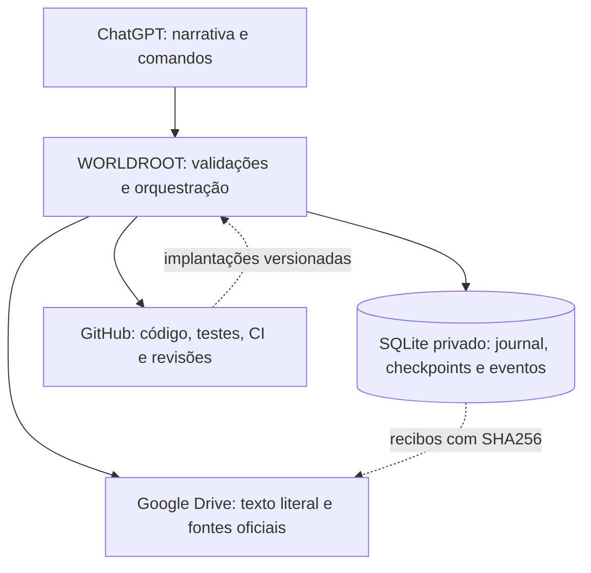

> **WORLDROOT r15 — PREFERÊNCIA AUTORAL: VIVER A HISTÓRIA, NÃO RELATAR PROJETOS (18/11/2026).** Auditoria C16 Parte IV vs C15 Parte II: 13.376 palavras no arquivo vs 10.046, mas 15 cenas em quatro dias vs nove cenas num dia. Meta de 10 mil deve servir imersão. Política v6 P28–P30, `worldroot/lived_narrative_audit.py` e `docs/c16-piv-lived-narrative-audit-r15.md` previnem regressão de ritmo por checklists. Alerts LIFE01–04 são avisos estruturais, não notas estéticas; entrega continua exigindo leitor/editor e `delivery_gate`. Nenhum episódio antigo, escolha, HEAD, Base Viva ou Drive foi reescrito por esta diretriz.

> **WORLDROOT r14.1 · reader delivery gate (18/11/2026).** Capítulos longform não são considerados entregues quando estão apenas no chat: exige inbox explícito, workflow verde, pacote imutável, SHA/readback e worldroot/delivery_gate.py com release_allowed=true **antes** das cinco escolhas. Em trechos, salvar segmentos e manter a mesma Parte até o final. Dia final pode avançar mais de um dia somente com todos os dias narrados em sequência e cronologia conferida. Ver docs/reader-release-gate-r14-1.md. ARGOS: Coração de Voo + Matriz de Compensação, jamais converter em jato terrestre por conveniência.

> **WORLDROOT r14 — NOVA META LONGFORM / RECUPERAÇÃO (18/11/2026).** Política editorial v5 (P01–P27). Após crítica autoral à extensão de Livro V C16 Parte III, a produção dos próximos episódios visa **~10.000 palavras de prosa das cenas** (não contagem de UI/5 escolhas), janela ideal 9.400–11.000 e piso técnico 8.800 para **novos** rascunhos. `worldroot/longform_depth.py` e `worldroot/draft_inbox.py` verificam a extensão; `worldroot/longform_segments.py` permite reunir de modo verificável 2–6 segmentos privados escritos em diferentes mensagens, se necessário. `docs/longform-10k-context-recovery.md` estabelece recuperação QUENTE/MORNA/FRIA por evidência antes de narrar. Testes estruturais não certificam qualidade literária. O último HEAD é dinâmico em `story-archive`; não fixar datas neste README nem assumir escolha do autor. Nada aqui modifica capítulos, HEAD, Drive, Base Viva ou Atlas.

> **WORLDROOT r12 — STATUS OPERACIONAL DINÂMICO (18/11/2026).** O último estado da história **NÃO** está fixado neste README. Antes de narrar ou arquivar, buscar o HEAD real em `story-archive/canon/HEAD.json`, o índice derivado `canon/CONTEXT.json` e o último draft em `story-archive/episodes/*/draft/`. A branch privada `story-archive` é a fonte operacional para novos episódios, enquanto `main` contém o código e as regras aprovadas. Um draft só vira cânone após escolha autoral real, fechamento e readback. Não usar snapshots antigos das versões r8/r10 como o HEAD atual.

> **REPAROS E DIREÇÃO VIGENTES (r13).** PRs #17/#18/#19/#21: foco narrativo, profundidade e ciclo diário vivido como alertas editoriais; política `worldroot/editorial_policy.json` v4 (25 diretrizes), contrato de apresentação rico UX01–UX12, temporalidade de cada evento e conhecimento respeitada. Projeções SQLite/CONTEXT reconstruídas a partir do journal imutável com `canon/temporal-reconciliation.json`, sem alterar texto, escolhas, HEAD ou o Drive. Consulte [instrução dinâmica](docs/instrucao-unica-projeto-chatgpt.md), [auditoria de profundidade](docs/story-density-focus-qa-D529-D530.md), [ciclo diário vivido](docs/lived-day-arcs-D533.md), [reparo temporal](docs/temporal-repair-literary-depth-r12.md). **Drive, Atlas e Base Viva continuam sem sincronização automática via GitHub**. Actions não geram narrativa e não capturam escolhas sem ação explícita do conector.

# WORLDROOT — CRÔNICAS DE UM NOVO MUNDO

**Repository role:** PRIVATE story and source-code history. Code is developed on `worldroot/**`; the original story text and recovery packages are stored in `story-archive`. Google Drive remains the authoritative narrative document archive; SQLite is an operational projection and must be durably backed up. Do not log character secrets, credentials, or unpublished scenes in CI outputs or external issues.

## WORLDROOT r7 — motor on main, production gates still protected

The code integrated on `main` hardens r7 without retcon: `worldroot/drive_bridge.py` provides a real Google Drive API transport (optional `pip install .[drive]` + trusted ADC credentials), `worldroot/memory.py` provides evidence-first per-character temporal knowledge, `worldroot/narrative.py` provides book/choices/style preflight, `worldroot/backup.py` provides restore-verified SQLite backups, and `worldroot/legacy.py` reads the existing 4.3 FTS archive without modifying it.

**No authenticated runtime credentials are configured in the repository or in GitHub Actions.** The Drive synchronizer is tested with synthetic fixtures; the production cloud bridge, Base/Atlas transaction coordinator and autonomous chapter saving remain pending. Under no circumstances should the private 105MB literal index be committed to the code branch. Private narrative drafts are kept only on the restricted `story-archive` branch; no secret material belongs in CI logs. See [hardening roadmap](docs/hardening-r7-roadmap.md).

## Architecture



The code does **not** claim a live server or automatic ChatGPT hook. A ChatGPT session with access to authenticated tools can call the relevant Drive/GitHub connector actions; this module alone has no privileged cloud access.

## Zero-cost installation and local test

```bash
python -m unittest discover -s tests -v
python -m worldroot.cli --root ./runtime status
```

Use `python -m worldroot.cli --help` for preparation/validation/archiving. The `.gitignore` intentionally excludes runtime/private/story content. A generic caller-supplied readback is no longer accepted. The trusted production adapter must call Google APIs to fetch bytes and compare hashes; tests explicitly opt in to a fake service. The HEAD publisher also demands a Google Docs revision readback and author approval.

## Narrative publication protocol

`PREPARADO → VALIDADO → GRAVADO → CONFERIDO → CONFIRMADO`

1. The assistant narrates a complete installment, displays its options and archives it as RASCUNHO; only the author's next actual choice authorizes the guarded closure of that prior installment.
2. Prepare a stable delivery ID, full UTF-8 text and SHA256, strict date/location metadata, proposed events and visibility labels.
3. Validate metadata and expected chronology; store literal bytes atomically, then read them back locally.
4. A connected orchestrator uploads the same bytes to the authorized Google Drive location and **fetches the bytes again**. It registers the verified external receipt; generation or upload alone is not enough.
5. `confirm` closes the ledger **only after a verified Drive readback**, and `promote` may update the canonical checkpoint only with explicit author approval and verified external receipt. The HEAD Google Docs CAS adapter and durable outbox now exist, but Base/Atlas and Wiki updates are **not yet coordinated as a full production transaction**.
6. Rerun operations safely: same ID and bytes are idempotent; altered content for an existing delivery ID is rejected.

See `docs/architecture.md` and `docs/release-r7.md` for interfaces and release qualification. Synthetic tests do not prove every historical day or character relationship has been reconciled.

## Explicit live Drive sync (trusted private runtime only)

```bash
# Only after local `prepare`, `validate`, `write` and `verify` have completed:
pip install '.[drive]'
# Set ADC credentials OUTSIDE GitHub in a separately authorized runner.
python -m worldroot.cli --root ./runtime sync-drive --id SYNTHETIC_ID --folder-id ACTUAL_RESTRICTED_FOLDER_ID
```

This command does not send credentials or chapter content to GitHub and does not publish HEAD. If no ADC credentials are present, it fails instead of pretending to upload.

## Episode handoff: draft on options, canon on the next author choice

This project now includes `worldroot/episode_handoff.py`, `worldroot/private_github.py`,
`worldroot/sheets_index.py` and `worldroot/episode_cli.py`. Run:

```sh
python -m unittest discover -s tests -v
python -m worldroot.episode_cli --help
```

**No background ChatGPT hook is installed.** The host must capture the FULL
rendered episode and explicitly run the stage command, then run the closure
command after receiving the next genuine author selection. The story archive
always requires a verified **private** repository and independent readback.
The reviewed engine is now integrated into `main`; production publication remains disabled until authenticated end-to-end validation.
See [episode lifecycle](docs/ciclo-de-episodios.md).


## Operation status — choice-only goal (r7)

- The private GitHub `story-archive` branch contains the **literal** D529 Part II draft (`LV-C15-PII-D529-AUTHOR-SOURCE`), with SHA256 and five choices; integrity-check GitHub Actions ran **successfully**.
- Latest Drive and GitHub draft reads succeeded. **The official HEAD is still D528.** D529 Part II has not been promoted, and the user's next choice remains outstanding.
- The semantic event sidecar of this immutable draft is `[]`. Evidence-linked **candidates** (11 events, 6 knowledge updates) are in `episodes/LV-C15-PII-D529-AUTHOR-SOURCE/review/`. They are NOT canon or an automatic full knowledge reconciliation.
- `main` includes the fail-closed next-choice pipeline, evidence-based canonical event gate (`worldroot/semantic_gate.py`), read-only orchestrator and choice-intake gate (`worldroot/choice_intake.py`). The private `story-archive` branch has the read-only choice-intake workflow, which runs only after a real choice file is committed.
- Google Drive mirroring from Actions is **not yet active**. WIF/OIDC, restricted Drive sharing, persistent SQLite replay, a deterministic close job, and a remote end-to-end test remain required.
- Read `docs/choice-first-automation-architecture.md` before enabling any privileged workflow. GitHub Actions can run on Git events, but cannot read a new ChatGPT reply/choice unless a trusted ChatGPT-side invocation posts that event.

**Never mark an episode CANÔNICO merely because a code/QA workflow passed.** The next genuine author choice must close the previous archive, Base Viva and Atlas must be checked, and the official Drive HEAD must advance last.


## Release and automation checkpoint

- **Code branch:** `main`, release r7 with read-only GitHub Actions test/audit gates. The `story-archive` branch is private and separate.
- **Canonical narrative authority:** the Google Drive HEAD document, **D528** with documented caveats. D529 Part II is an immutable **draft** awaiting a genuine author choice; do not retroactively rewrite it.
- **Author choice intake:** an explicit GitHub connector/app write of `choices/<episode-id>/option-<1..5>.json` triggers `story-archive/.github/workflows/choice-intake-qa.yml`, a read-only validation. It checks the choice shape and archived five-choice integrity **but does not advance the canonical HEAD**.
- **Pending production gates:** Google WIF/OIDC, restricted Drive sharing, durable SQLite snapshot/outbox and crash-recovery validation, verified Base Viva/Atlas semantic updates, and a fully authenticated episode closer.
- **GitHub governance:** `main` and `story-archive` currently require branch protection/ruleset configuration. A successful CI job is not equivalent to approved canon.

Current operational documents: [deployment status](docs/operational-deployment-status.md), [choice intake](docs/choice-intake-contract.md), [choice-first architecture](docs/choice-first-automation-architecture.md).
